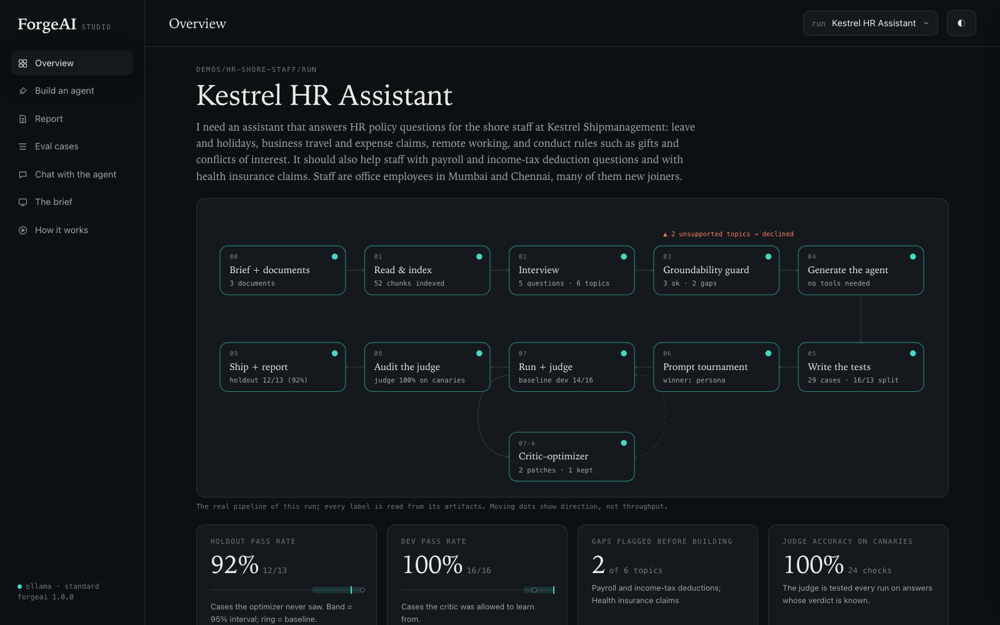
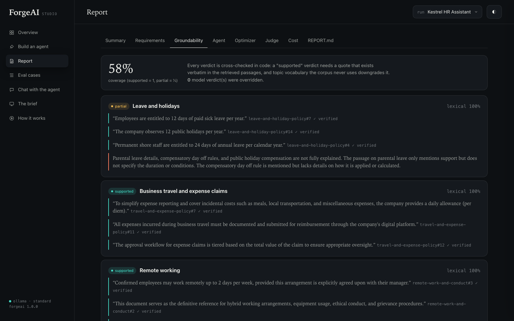
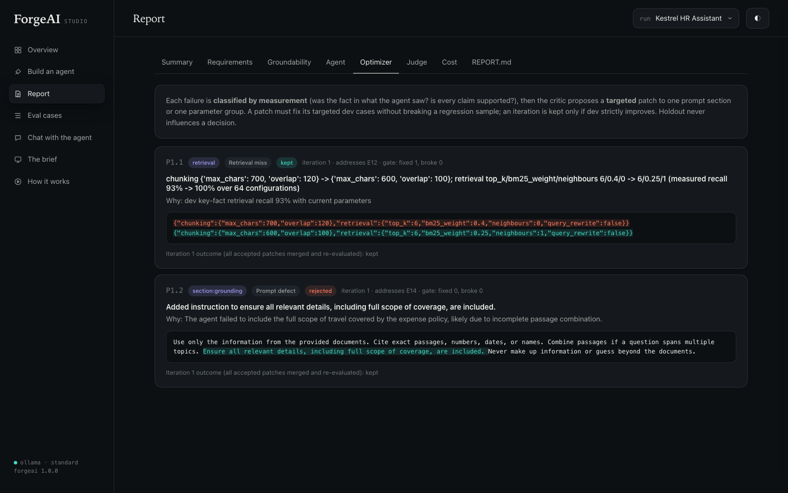
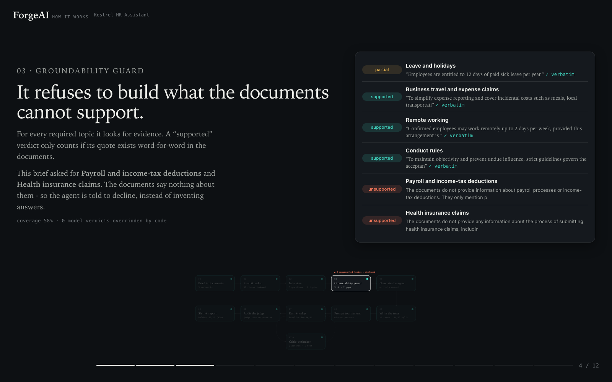

# ForgeAI: the agent that builds agents

ForgeAI takes a **one-paragraph brief and a folder of documents**. It interviews the requester, refuses to build what the documents cannot support, generates a declarative agent, **writes its own test set**, judges the agent like a QA engineer, diagnoses every failure, applies **targeted** fixes, and ships the agent with a report that leads with the number you should trust and says plainly what still fails.

Everything runs locally on small open models through Ollama (8B factory and agent, a 4B judge from a different model family, and a 137M embedder). The models were chosen by measurement ([docs/MODEL_SELECTION.md](docs/MODEL_SELECTION.md)). It works on Windows, macOS and Linux with two Python dependencies (`numpy`, `pypdf`).

```text
forge build --brief-file brief.md --docs ./docs --unattended
```

| | |
|---|---|
| **Demo 1: HR policy assistant** (3 PDFs) | [`demos/hr-shore-staff/run/REPORT.md`](demos/hr-shore-staff/run/REPORT.md) |
| **Demo 2: ship-spares procurement** (catalogue CSV + 4 PDFs, needs tools) | [`demos/ship-spares-procurement/run/REPORT.md`](demos/ship-spares-procurement/run/REPORT.md) |
| **Benchmark on briefs the factory was never tuned on** | [`bench/RESULTS.md`](bench/RESULTS.md) |
| Architecture and design rationale | [`docs/ARCHITECTURE.md`](docs/ARCHITECTURE.md) |
| The brief (presentation deck, generated from the artifacts) | [`docs/FORGEAI.brief`](docs/FORGEAI.brief): present it in Studio → *The brief* |
| Factory vs a hand-written agent | [`demos/hr-shore-staff/human_baseline/COMPARISON.md`](demos/hr-shore-staff/human_baseline/COMPARISON.md) |
| Regression mode (documents changed) | [`demos/hr-shore-staff/regression/REGRESSION.md`](demos/hr-shore-staff/regression/REGRESSION.md) |



## Results at a glance

| | Holdout (never seen by the optimizer) | Dev | Notes |
|---|---|---|---|
| **HR policy assistant** (3 PDFs) | **12/13** (92%, CI 67–99%) | 16/16 | 2 gaps flagged and declined; no tools; optimizer kept 1 retrieval patch (dev 14→16, holdout 13→12, reported) |
| **Ship-spares procurement** (CSV + 4 PDFs) | **11/13** (85%, CI 58–96%) | 15/17 | weather tool-backed, shipment tracking a gap; tools: csv_lookup, calculator, weather |
| **Factory vs hand-written agent** (HR) | factory **28/29** vs human 26/29 | | same model, runtime and judge |
| **5 unseen briefs** | 5/5 correct outcomes; built agents average 88% holdout | | adversarial brief stopped at the guard ([bench/RESULTS.md](bench/RESULTS.md)) |
| **Judge audit** | 24/24 canaries in every run | | verbosity effect +0 pts |
| **Replay with no model** | HR 36/36, procurement 33/33 artifacts identical | | only timing fields excluded |

---

## Why trust it

A factory built from small models will make mistakes, so it has to distrust its own pipeline and carry the checks that catch it lying. ForgeAI follows one rule: **a small model's claim is never believed until code verifies it.**

| Where a small model could lie | The check that catches it |
|---|---|
| "The documents support this topic" | Its evidence quote must exist **verbatim** in a retrieved passage. If no quote verifies, the verdict is downgraded. A lexical cross-check overrides verdicts on vocabulary the corpus never uses. |
| "This is the key fact for the test question" | The fact must be a verbatim span of the source passage. A paraphrase is repaired to the exact span or dropped. Boilerplate facts, and quantity questions whose fact has no number, are rejected. |
| "This question tests grounding" | A closed-book probe asks the agent's model without documents. If it already knows the answer, the case is dropped (it would measure memory, not grounding). |
| "The agent answered correctly" (on a conditional rule) | Rule-application tests describe a concrete situation (a city, a distance, an amount) where a condition picks the value. The correct value and the tempting wrong one are both verified verbatim. Quoting the wrong row is reported as *rule misapplied*. |
| "This question must be refused" | The label is checked against the corpus by a second model with a verified quote and by lexical coverage. Mislabelled tests are dropped. |
| "The answer states the fact" | Exact and numeric matching first. The LLM judge only sees one fact at a time, and its quote must be in the answer. A changed number is never forgiven. |
| "Every claim is supported" | Each sentence is checked against what the agent actually saw. Numbers missing from every source are flagged deterministically. |
| "This patch fixes the agent" | It must fix its targeted dev cases without breaking a regression sample. The merged iteration is kept only if dev strictly improves, with flips and a McNemar p-value reported. |
| "The agent is 90% good" | The headline is the **holdout** score, which the optimizer never saw, with a 95% Wilson interval and the dev−holdout gap. |
| "The judge is reliable" | Every run scores labelled canaries: correct answers, corrupted facts, padded answers (verbosity) and fabricated claims. The judge's own accuracy goes in the report. |
| "This tool is needed" | A tool must serve a requirement the corpus/tools can support, must meet its preconditions, and must not serve a gap. Tools the agent never used are pruned empirically. |

## Capabilities, mapped to code

| # | Capability | Where | How |
|---|---|---|---|
| 1 | Intake interviewer, ≤5 questions, structured requirements | `factory/intake.py` | Profiles each document, drafts requirements, and asks ≤5 high-impact questions, each with a stated default. Answers come from the terminal, requester notes (verbatim-quoted), an answers file, or the default. The source of every answer is recorded. Optional human checkpoint (`--approve`). |
| 2 | Groundability guard | `factory/groundability.py` | Per-topic verdicts with verified evidence. Topics that need live data (weather, today's date) are tool-backed by registry capability, not gaps. Gaps become explicit refusal topics, and the refusal message never advertises a gap. If coverage is below 25%, the factory **stops** and builds nothing. |
| 3 | Agent generator | `factory/generator.py`, `runtime/definition.py` | `forgeai.agent/1` JSON with a sectioned system prompt, chunking and retrieval parameters, gated tools with reasons, an output contract, guards and a refusal policy. |
| 4 | Eval generator (≥20, generated) | `factory/evalgen.py`, `prompts/evalgen.*.md` | Case kinds: answerable, multi-document, rule application (with a verified trap value), edge (re-phrased), tool, out-of-scope, must-refuse, gap probes. Self-checks as above. Stratified dev/holdout split with no paraphrase leakage. |
| 5 | Judge with bias defences | `factory/judge.py` | Deterministic first, then a pointwise LLM with verified quotes, a different-family judge, and a canary audit every run. |
| 6 | Critic–optimizer, ≤3 iterations, logged | `factory/optimizer.py` | Failure categories are measured, not guessed. Targeted patches: retrieval grid search on measured recall, query rewrite, calibrated abstention threshold, or a critic edit of one prompt section (adding numbers is forbidden). Each patch is gated, then kept or reverted. `07_changes.jsonl` logs every change. |
| 7 | Honest reporting | `factory/report.py` | Leads with holdout and its CI, then what still fails and why (by measured category, with the cases), every change tried, judge accuracy, and the limits of the evidence. |
| 8 | Runnable product | `runtime/agent.py`, `forge chat` | A generic runner for **any** definition. It is the same runtime the evals use. |
| 9 | Two full demonstrations | `demos/*/run/` | All artifacts committed, plus a replay cache. |

**Extensions:** prompt tournament (3 styles, scored on dev, pointwise so there's no position bias) · budget enforcement (`--max-minutes/--max-tokens`; stages shrink, then the loop stops early when an iteration stops paying) · human checkpoint (`--approve`) · regression mode (`forge regress`) · web UI (`forge ui`, ForgeAI Studio) · factory-vs-human baseline ([`demos/hr-shore-staff/human_baseline/COMPARISON.md`](demos/hr-shore-staff/human_baseline/COMPARISON.md)).

## ForgeAI Studio

`forge ui` opens a local web app built with the standard library and hand-written HTML, CSS and JS. It has no extra dependencies and works offline on Windows, macOS and Linux.

- **Overview**: the run's real pipeline as an animated factory map, the headline holdout score with its interval, gaps, and judge accuracy.
- **Build an agent**: paste a brief and drop files (or point at a folder). The factory map lights up stage by stage as the run streams its own log.
- **Report**: requirements and interview (with answer sources), groundability evidence, tool decisions, the sectioned prompt, the prompt tournament, every optimizer patch as a word-level diff with its gate result, the judge audit, and cost by stage.
- **Eval cases**: filter all generated tests. Click one to see the expected facts, the answer, each fact's verdict with *who decided it* (code or model), each claim, and the exact passages the agent saw.
- **Chat**: talk to any produced agent. Citations open the exact passage, with tool calls and refusals shown.
- **The brief**: the presentation deck (`docs/FORGEAI.brief`, the same `.brief` format as the EVIDENT deck), with every number generated from the committed artifacts by `scripts/make_brief.py`. Present it full screen with `P` autoplay and `N` speaker notes.
- **How it works**: a scene-by-scene explainer driven by the selected run's real artifacts. Press `R` for a clean recording mode.

| | |
|---|---|
|  |  |
|  |  |

## Quick start

### Windows (PowerShell)

```powershell
# 1. Install Python 3.10+ (python.org) and Ollama (ollama.com/download/windows), then start Ollama.
# 2. One-time setup: venv, install, pull models, run tests, environment check
powershell -ExecutionPolicy Bypass -File scripts\setup_windows.ps1
.\.venv\Scripts\Activate.ps1
```

### macOS / Linux

```bash
./scripts/setup.sh            # or: python3 -m venv .venv && .venv/bin/pip install -e ".[dev]"
source .venv/bin/activate
```

### Run it

```bash
forge doctor                                   # checks Python, Ollama, models, residency, speed
forge build --brief-file demos/hr-shore-staff/brief.md --docs demos/hr-shore-staff/docs
forge chat runs/<run-folder>                   # talk to the agent it built
```

Useful flags: `--unattended` (no questions; defaults are recorded as assumptions), `--answers notes.md` (answer the interview from requester notes), `--approve` (human checkpoint), `--max-minutes 25` (bounded live run), `--profile laptop|standard|tiny`, and `--backend openai --host http://localhost:1234/v1` (LM Studio, llama.cpp server, vLLM).

Other commands:

```text
forge eval RUN [--agent-model M --judge-model J]   re-run an eval set (e.g. after hand-editing agent.json)
forge regress RUN --docs NEW_FOLDER                documents changed: rebuild, re-run old evals, report what broke
forge replay RUN                                   re-execute a committed run from its cache - no model needed
forge ui                                           ForgeAI Studio: build live, inspect every artifact, chat, explain
```

## What a run produces

```text
runs/<name>-<timestamp>/
  REPORT.md                     the honest report (start here)
  02_requirements.md/.json      interview + requirements (answer sources recorded)
  03_groundability.md/.json     verdicts with verified evidence; gaps
  04_tool_decisions.json        every tool considered, gates, reasons
  05_evalset.json               generated cases, splits, self-check statistics
  06_tournament/                candidate prompts scored on dev
  06_iterations/iter_k/         responses, verdicts, scorecard per iteration
  07_changes.jsonl              every patch: what, why, cases, gate, before/after text
  08_judge_canaries.json        the judge's own accuracy
  agent/agent.json + knowledge/ the runnable agent;  agent/history/vN.json every accepted version
  manifest.json, trace.jsonl    settings, prompt hashes, artifact hashes, every model call
  llm_cache.sqlite              lets `forge replay` re-run everything with no model
```

## Models

| Profile | Factory | Agent | Judge | Embeddings | For |
|---|---|---|---|---|---|
| `standard` (default) | qwen3:8b | qwen3:8b | gemma3:4b | nomic-embed-text | a GPU or Apple silicon; best measured quality |
| `laptop` | qwen3:4b | qwen3:4b | gemma3:4b | nomic-embed-text | 8–16 GB RAM, CPU only |
| `tiny` | qwen3:1.7b | qwen3:1.7b | gemma3:4b | nomic-embed-text | very slow machines |

Each profile keeps three models resident, which matches Ollama's defaults, so no server configuration is needed. The judge always comes from a different family than the agent. Override any role with `--factory-model/--agent-model/--judge-model/--embed-model`.

## Tests

```bash
python -m pytest -q         # unit tests + an offline end-to-end factory run with a scripted model
```

The CI runs Windows, macOS and Ubuntu on Python 3.10 and 3.12, plus a replay of a committed demo run with no model installed.
