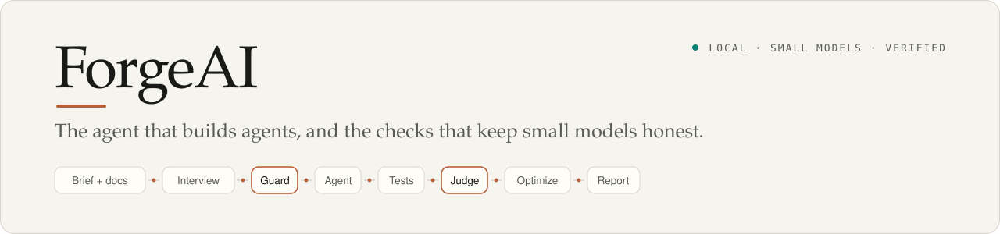
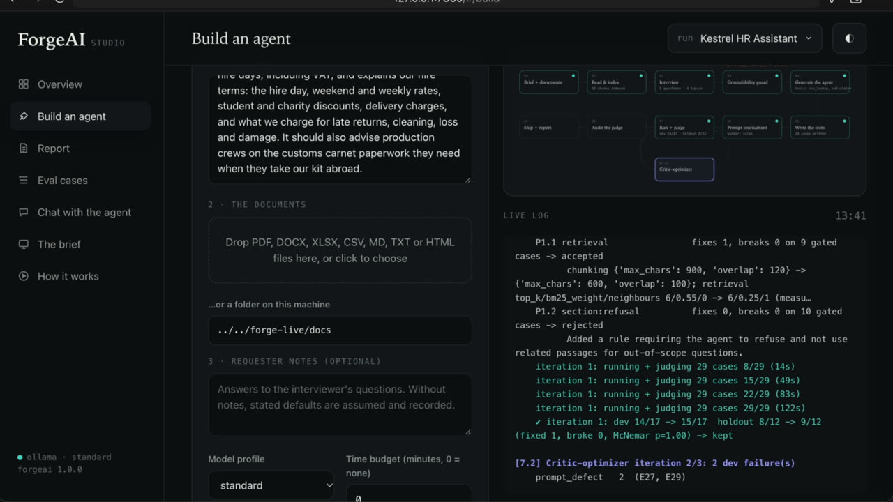
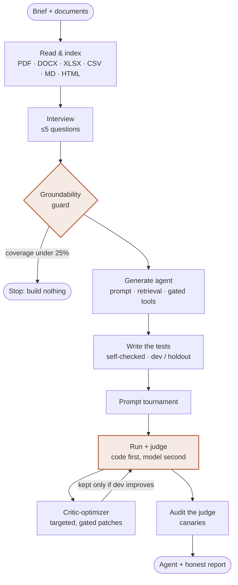
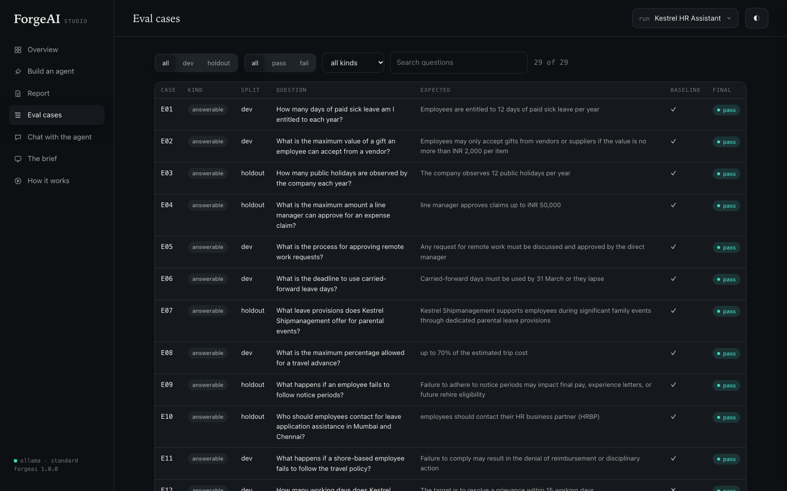

<div align="center">

<picture>
  <source media="(prefers-color-scheme: dark)" srcset="docs/assets/banner-dark.svg">
  
</picture>

<br>

[](https://github.com/divyat2605/forgeai/actions/workflows/ci.yml)
[](https://github.com/divyat2605/forgeai/releases)


-0B7F73)


**One paragraph and a folder of documents in. A tested, grounded agent and an honest report out.**<br>
It runs on small local models, and every claim those models make is checked by code.

[Quick start](#-quick-start) · [How it works](#-how-it-works) · [Results](#-results) · [Why trust it](#-why-trust-it) · [Studio](#-forgeai-studio) · [Docs](#-documentation)

</div>

## 🎬 Demo video (7 min)

<p align="center">
  <a href="https://github.com/divyat2605/forgeai/releases/download/v1.0.0/ForgeAI-demo.mp4">
    
  </a>
  <br>
  <sub><b><a href="https://github.com/divyat2605/forgeai/releases/download/v1.0.0/ForgeAI-demo.mp4">▶ Watch the demo</a></b>: a genuine, unattended run on a brief the factory had never seen (camera &amp; lighting hire desk, empty cache, 100% local). The guard flags the unsupported topic, tools are gated, one patch is accepted and others are rejected, and the report leads with the holdout score. Then chat with both committed agents, and CI.</sub>
</p>

---

ForgeAI is an **agent factory**. Give it a brief such as *"an assistant that answers HR policy questions for our office staff"* and a folder of PDFs, Word files, spreadsheets or web pages. It then:

1. **interviews** the requester (at most five questions, each with a recorded default),
2. **refuses to build on sand**: topics the documents cannot support are flagged before anything is generated,
3. **generates** a declarative agent (sectioned prompt, hybrid retrieval, only the tools it needs),
4. **writes its own exam**, then throws out the weak questions,
5. **judges** the agent like a QA engineer and measures *why* each case failed,
6. **repairs** it with targeted, gated patches, never a blind regeneration,
7. **ships** the agent with a report that leads with the score you should trust.

```bash
forge build --brief-file brief.md --docs ./docs   # run the factory
forge chat  runs/<run>                             # talk to its agent
forge ui                                           # or use the Studio
```

<p align="center"></p>

## 📊 Results

<table>
<tr>
<td align="center" width="25%"><h2>92%</h2><sub><b>HR agent, holdout</b><br>12/13 · never seen by the optimizer</sub></td>
<td align="center" width="25%"><h2>5 / 5</h2><sub><b>unseen briefs</b><br>correct outcome, incl. an adversarial stop</sub></td>
<td align="center" width="25%"><h2>28 vs 26</h2><sub><b>factory vs hand-written</b><br>same model, runtime and judge</sub></td>
<td align="center" width="25%"><h2>100%</h2><sub><b>judge on known-answer canaries</b><br>every run, +0 pts verbosity effect</sub></td>
</tr>
</table>

| Run | Holdout | Dev | What happened |
|---|:---:|:---:|---|
| [**HR policy assistant**](demos/hr-shore-staff/run/REPORT.md) · 3 PDFs | **12/13** (92%, CI 67–99%) | 16/16 | Payroll and health-insurance flagged as gaps and declined; no tools needed; one retrieval patch kept (dev 14→16; holdout 13→12, reported) |
| [**Ship-spares procurement**](demos/ship-spares-procurement/run/REPORT.md) · CSV + 4 PDFs | **11/13** (85%, CI 58–96%) | 15/17 | Weather tool-backed, shipment tracking declined; `csv_lookup` + `calculator` + `weather` attached |
| [**Factory vs hand-written agent**](demos/hr-shore-staff/human_baseline/COMPARISON.md) | factory **28/29** | human 26/29 | Identical model, runtime and judge; McNemar p = 0.62 |
| [**Benchmark: 5 unseen briefs**](bench/RESULTS.md) | **5/5** outcomes | mean 88% | Markdown, PDF, HTML, XLSX + DOCX; the adversarial brief stopped at the guard |
| [**Regression mode**](demos/hr-shore-staff/regression/REGRESSION.md) | 0 broke | 8 invalidated | Changed documents: stale tests separated from real breakage |
| **Replay with no model** | 36/36 · 33/33 | | Every artifact identical apart from timing fields, verified in CI on all three OSes |

## 🧭 How it works



Every stage writes its artifact as it finishes, so a run can be inspected, resumed after Ctrl-C, and **replayed with no model at all**. Design rationale is in [`docs/ARCHITECTURE.md`](docs/ARCHITECTURE.md).

## 🛡️ Why trust it

A factory built from small models will make mistakes, so it has to distrust its own pipeline. ForgeAI follows one rule: **a model's claim is never believed until code has checked it.**

| When a small model says… | …code checks that |
|---|---|
| "The documents support this topic" | its evidence quote exists **verbatim** in a retrieved passage; otherwise the verdict is downgraded |
| "This is the key fact for the question" | the fact is a verbatim span of the source (repaired to the exact span or dropped) and is informative, not boilerplate |
| "This question tests grounding" | the agent's model **cannot** answer it without the documents (closed-book leakage probe) |
| "This question must be refused" | two model families agree the topic is absent from the corpus |
| "The answer states the fact" | exact and numeric matching first; a model verdict needs a quote or every anchor of the fact in the answer; a changed number is never forgiven |
| "Every claim is supported" | each sentence is backed by what the agent actually saw; numbers missing from every source are flagged |
| "This patch fixes the agent" | it fixes its targeted cases without breaking a regression sample, and the iteration is kept only if dev strictly improves |
| "The agent is 90% good" | the headline is the **holdout** score with a 95% interval; the optimizer never sees those cases |
| "The judge is reliable" | it is scored every run on canaries: correct, corrupted, padded and fabricated answers |
| "This tool is needed" | the need is evidenced by a supported topic, preconditions hold, it serves no gap, and unused tools are pruned |

<details>
<summary><b>Capabilities, mapped to code</b></summary>
<br>

| Capability | Where | How |
|---|---|---|
| Intake interviewer | `factory/intake.py` | Profiles each document, drafts requirements, asks ≤5 high-impact questions with defaults; answers from the terminal, requester notes (verbatim-quoted), an answers file or the default, with every source recorded; optional human checkpoint (`--approve`) |
| Groundability guard | `factory/groundability.py` | Per-topic verdicts with verified evidence; live-data topics are tool-backed; gaps become refusal topics and the refusal message never advertises one; below 25% coverage the factory stops |
| Agent generator | `factory/generator.py`, `runtime/definition.py` | `forgeai.agent/1` JSON: sectioned system prompt, chunking and retrieval, gated tools with reasons, output contract, guards, refusal policy |
| Eval generator | `factory/evalgen.py`, `prompts/evalgen.*.md` | Answerable, multi-document, rule application (with a verified trap), edge, tool, out-of-scope, must-refuse and gap probes; stratified dev/holdout with no paraphrase leakage |
| Judge | `factory/judge.py` | Deterministic first, pointwise model checks second, different-family judge, canary audit |
| Critic–optimizer | `factory/optimizer.py` | Measured failure categories; retrieval grid search, query rewrite, calibrated abstention, or one prompt section; every patch gated and logged in `07_changes.jsonl` |
| Honest report | `factory/report.py` | Holdout first with its interval, what still fails and why, every change tried, judge accuracy, limits of the evidence |
| Runtime | `runtime/agent.py` | One generic runner for any definition, shared by chat and evaluation |
| Extensions | `forge ui`, `forge regress`, `--max-minutes` | Prompt tournament, budget-aware early stopping, human checkpoint, regression mode, web studio, factory-vs-human baseline |

</details>

## 🖥️ ForgeAI Studio

`forge ui` opens a local web app with **no extra dependencies**: the standard-library server and hand-written HTML, CSS and JS. It works offline on every OS.

| | |
|:---:|:---:|
| <br><sub><b>Groundability</b>: every verdict with its verified quote</sub> | <br><sub><b>Optimizer</b>: every patch as a diff, with its gate result</sub> |
| <br><sub><b>Eval cases</b>: down to the passages the agent saw</sub> | <br><sub><b>How it works</b>: a scene-by-scene explainer from real artifacts</sub> |

Also in the Studio: **Build an agent** (the factory map lights up live as a run streams), **Chat** (citations open the exact passage), and **The brief**, a presentation deck whose every number is generated from the committed artifacts ([`docs/FORGEAI.brief`](docs/FORGEAI.brief)).

## 🚀 Quick start

**1. Install** [Python 3.10+](https://www.python.org/downloads/) and [Ollama](https://ollama.com/download), and start Ollama.

**2. Set up** (creates a virtual environment, installs, pulls the models, runs the tests and checks the machine):

```powershell
# Windows (PowerShell)
powershell -ExecutionPolicy Bypass -File scripts\setup_windows.ps1
.\.venv\Scripts\Activate.ps1
```

```bash
# macOS / Linux
./scripts/setup.sh && source .venv/bin/activate
```

**3. Run:**

```bash
forge doctor          # check Python, Ollama, models and speed
forge build --brief-file demos/hr-shore-staff/brief.md --docs demos/hr-shore-staff/docs
forge ui              # ForgeAI Studio at http://127.0.0.1:7860
```

<details>
<summary><b>All commands and flags</b></summary>
<br>

```text
forge doctor                                 check the environment and recommend a profile
forge build  --brief-file B --docs D         run the factory
forge chat   RUN [-q "question"]             chat with a produced agent (generic runner)
forge eval   RUN [--agent-model M]           re-run an eval set, e.g. after hand-editing agent.json
forge regress RUN --docs NEW                 documents changed: rebuild, re-run old tests, report what broke
forge replay RUN                             re-execute a committed run from its cache, with no model
forge ui                                     ForgeAI Studio
```

| Flag | Effect |
|---|---|
| `--unattended` | no questions; stated defaults are assumed and recorded |
| `--answers notes.md` | answer the interview from requester notes (verbatim quotes only) |
| `--approve` | human checkpoint: approve or edit the requirements before generation |
| `--max-minutes N` | soft time budget: smaller test set, no tournament, early-stopped loop |
| `--profile standard\|laptop\|tiny` | model profile (below) |
| `--backend openai --host URL` | any OpenAI-compatible server (LM Studio, llama.cpp, vLLM) |
| `--resume RUN` | continue an interrupted run; cached calls are free |

</details>

<details>
<summary><b>Models: chosen by measurement</b></summary>
<br>

| Profile | Factory | Agent | Judge | Embeddings | For |
|---|---|---|---|---|---|
| `standard` | qwen3:8b | qwen3:8b | gemma3:4b | nomic-embed-text | a GPU or Apple silicon |
| `laptop` | qwen3:4b | qwen3:4b | gemma3:4b | nomic-embed-text | 8–16 GB RAM, CPU only |
| `tiny` | qwen3:1.7b | qwen3:1.7b | gemma3:4b | nomic-embed-text | very slow machines |

The judge always comes from a different family than the agent. Each profile keeps three models resident, matching Ollama's defaults, so there's nothing to configure. The comparison that chose them is in [`docs/MODEL_SELECTION.md`](docs/MODEL_SELECTION.md).

</details>

<details>
<summary><b>What a run produces</b></summary>
<br>

```text
runs/<name>-<timestamp>/
  REPORT.md                     the honest report (start here)
  02_requirements.md/.json      interview + requirements (answer sources recorded)
  03_groundability.md/.json     verdicts with verified evidence; gaps
  04_tool_decisions.json        every tool considered, gates, reasons
  05_evalset.json               generated cases, splits, self-check statistics
  06_tournament/                candidate prompts scored on dev
  06_iterations/iter_k/         responses, verdicts, scorecard per iteration
  07_changes.jsonl              every patch: what, why, cases, gate, before/after
  08_judge_canaries.json        the judge's own accuracy
  agent/agent.json + knowledge/ the runnable agent; agent/history/ every accepted version
  manifest.json, trace.jsonl    settings, prompt and artifact hashes, every model call
  llm_cache.sqlite              lets `forge replay` re-run everything with no model
```

</details>

## 📚 Documentation

| Document | What it covers |
|---|---|
| [`docs/ARCHITECTURE.md`](docs/ARCHITECTURE.md) | The pipeline, and the failure mode each safeguard exists for |
| [`docs/MODEL_SELECTION.md`](docs/MODEL_SELECTION.md) | Seven agent/judge pairings on one frozen test set |
| [`docs/FORGEAI.brief`](docs/FORGEAI.brief) | The presentation deck, generated from the artifacts (present it in Studio) |
| [`bench/RESULTS.md`](bench/RESULTS.md) | Five briefs the factory was never tuned on, with per-brief reports |
| [`CHANGELOG.md`](CHANGELOG.md) | Release notes |

## 🧪 Tests

```bash
python -m pytest -q   # unit tests + an offline end-to-end run
```

CI runs on **Windows, macOS and Ubuntu × Python 3.10 and 3.12**, and replays both committed demo runs with no model installed.

<div align="center"><br><sub>Built to run on a laptop: small open models, two dependencies, and code that verifies them.</sub></div>
